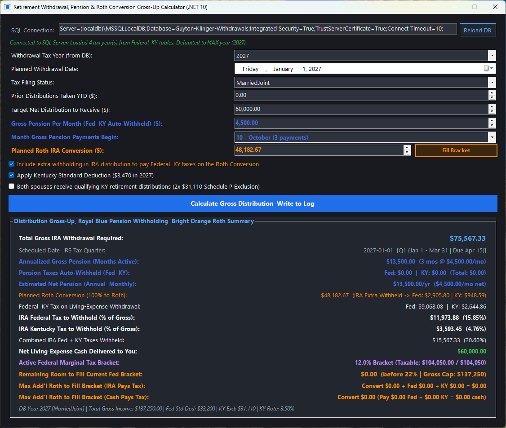

# Retirement Distribution, Pension & Roth Conversion Gross-Up Calculator (`.NET 10`)



A high-contrast, Dark Mode Windows Forms (`.NET 10`) desktop application designed for the **Guyton-Klinger Withdrawal Strategy** repository (`[Guyton-Klinger-Withdrawals]`). This tool solves the recursive Federal and Kentucky state income tax gross-up problem to determine the exact **Gross IRA/401(k) Distribution** required to deliver a target **Net Cash Payout**, while accounting for prior Year-To-Date (YTD) distributions, **self-withholding monthly pension streams**, and **Traditional-to-Roth IRA conversions**.

---

## Key Features

### 1. 100% Database-Driven Tax Engine
* **Dynamic SQL Server Discovery:** Connects directly to `[Guyton-Klinger-Withdrawals]` on `(localdb)\MSSQLLocalDB` and queries three core tables:
  * `[dbo].[FederalStandardDeductions]`
  * `[dbo].[FederalTaxRates]`
  * `[dbo].[KentuckyTaxRates]`
* **Auto-Default to `MAX(TaxYear)`:** Populates the **Withdrawal Tax Year** dropdown in descending order and automatically defaults to the highest complete tax year in the database (e.g., `2027`).
* **Smart Withdrawal Date Synchronization:** Defaults the **Planned Withdrawal Date** picker to **January 1** of the selected withdrawal year (`2027-01-01`), or to **today's date (`DateTime.Today`)** when launched during the active tax year of withdrawal. Automatically maps the chosen date to the corresponding **IRS Form 1040-ES Estimated Tax Quarter** (`Q1`–`Q4`).

### 2. Self-Withholding Pension Engine (Royal Blue Theme `#4169E1`)
* **Automatic Federal & KY Withholding:** Accepts an estimated **Gross Monthly Pension** and the **Month Payments Begin (`1`–`12`)** for that tax year.
* **Deduction & Bracket Stacking:** Computes the annualized gross pension ($\text{Monthly Gross} \times (13 - \text{Start Month})$), applies it against the Federal Standard Deduction and Kentucky Schedule P Retirement Income Exclusion + Standard Deduction (after any Prior YTD distributions), and automatically withholds the pension's Federal and Kentucky taxes directly from the pension stream.
* **Royal Blue Visual Grouping:** Displays all pension inputs and outputs—including **Annualized Gross Pension**, **Pension Taxes Auto-Withheld (Fed & KY)**, and **Estimated Net Pension (Annual & Monthly)**—in high-contrast **Royal Blue**.

### 3. Iterative IRA Gross-Up Solver
* **Binary Search Convergence:** Because withholding taxes from a retirement distribution increases the taxable distribution itself, the engine uses a 100-iteration binary search solver to find the exact **Required Gross IRA Withdrawal** ($G$) stacked on top of $(\text{Prior YTD} + \text{Annual Gross Pension} + \text{Planned Roth Conversion})$ such that:
  $$G - \Delta\text{FedTax}(G) - \Delta\text{KyTax}(G) = \text{Target Net Distribution}$$
* **Custodian Withholding Percentages:** Outputs exact dollar withholdings alongside the **Effective Federal (%)**, **Effective Kentucky (%)**, and **Combined (%)** withholding rates required for brokerage/custodian withdrawal election forms.

### 4. Bright Orange Roth Conversion Bracket-Fill Analyzer (`#FF8C00`)
* **Planned Roth Conversion Input:** Models a Traditional-to-Roth IRA conversion where 100% of the converted principal transfers into the Roth IRA, with an option to include the conversion's Federal and Kentucky tax liability inside the living-expense IRA withdrawal.
* **Active Federal Bracket Headroom:** Evaluates where your cumulative ordinary income lands in the progressive Federal tax brackets and highlights in **Bright Orange**:
  1. **Remaining Room to Fill Current Federal Bracket ($\Delta_{\text{room}}$)** before crossing into the next marginal tax rate.
  2. **Max Additional Roth Conversion (IRA Pays Tax):** Solves for the exact Roth conversion principal ($R_{\text{fill}}$) + Federal tax ($T_{\text{fed}}$) + Kentucky tax ($T_{\text{ky}}$) such that the conversion plus the extra IRA withdrawal to pay its taxes equals 100% of the remaining bracket room:
     $$R_{\text{fill}} + T_{\text{fed}}(\Delta_{\text{room}}) + T_{\text{ky}}(\Delta_{\text{room}}) = \Delta_{\text{room}}$$
  3. **Max Additional Roth Conversion (Cash Pays Tax):** Shows the full conversion capacity ($\Delta_{\text{room}}$) and external cash tax cost if taxes are paid outside the IRA.
* **One-Click `Fill Bracket` Button:** Automatically populates the **Planned Roth IRA Conversion ($)** input with the exact amount needed to top off the active Federal tax bracket.

### 5. Wide No-Wrap Dark Mode UI & File-Only Serilog Diagnostics
* **Wide `1140x960` Dialog Layout:** Engineered with a `38% / 62%` label-to-value column split so multi-value summary rows containing six-figure (`$100,000.00+`) currency strings render cleanly on a single line without wrapping.
* **Strict File-Only Logging:** Uses **Serilog** (`Serilog.Sinks.File`) to write structured calculation audits, SQL diagnostics, and unhandled exception traces to `./logs/tax-grossup-YYYYMMDD.log`.

---

## Technical Requirements & NuGet Packages

* **Target Framework:** `.NET 10.0` (`net10.0-windows`, Windows Forms)
* **Database Engine:** Microsoft SQL Server LocalDB (`(localdb)\MSSQLLocalDB`) — Database: `[Guyton-Klinger-Withdrawals]`
* **Required NuGet Packages:**

```powershell
dotnet add package Microsoft.Data.SqlClient --version 6.1.8
dotnet add package Serilog --version 4.2.0
dotnet add package Serilog.Sinks.File --version 6.0.0
```

---

## Database Schema (`[Guyton-Klinger-Withdrawals]`)

Ensure the following three tables exist and are populated in `[Guyton-Klinger-Withdrawals]`:

### 1. `[dbo].[FederalStandardDeductions]`
```sql
CREATE TABLE [dbo].[FederalStandardDeductions](
    [DeductionID] [int] IDENTITY(1,1) NOT NULL PRIMARY KEY CLUSTERED,
    [TaxYear] [int] NOT NULL,
    [FilingStatus] [varchar](50) NOT NULL,
    [DeductionAmount] [money] NOT NULL,
    CONSTRAINT [UQ_StdDed_Year_Status] UNIQUE NONCLUSTERED ([TaxYear] ASC, [FilingStatus] ASC)
);
```

### 2. `[dbo].[FederalTaxRates]`
```sql
CREATE TABLE [dbo].[FederalTaxRates](
    [RateID] [int] IDENTITY(1,1) NOT NULL PRIMARY KEY CLUSTERED,
    [TaxYear] [int] NOT NULL,
    [FilingStatus] [varchar](50) NOT NULL,
    [TaxRate] [decimal](5, 4) NOT NULL,
    [IncomeMin] [money] NOT NULL,
    [IncomeMax] [money] NULL,
    CONSTRAINT [UQ_TaxYear_Status_Min] UNIQUE NONCLUSTERED ([TaxYear] ASC, [FilingStatus] ASC, [IncomeMin] ASC)
);
```

### 3. `[dbo].[KentuckyTaxRates]`
```sql
CREATE TABLE [dbo].[KentuckyTaxRates](
    [KyRateID] [int] IDENTITY(1,1) NOT NULL PRIMARY KEY CLUSTERED,
    [TaxYear] [int] NOT NULL,
    [TaxRate] [decimal](5, 4) NOT NULL,
    [StandardDeduction] [money] NOT NULL,
    [PensionExclusion] [money] NOT NULL,
    CONSTRAINT [UQ_KyTaxRates_TaxYear] UNIQUE NONCLUSTERED ([TaxYear] ASC)
);
```

#### Official Kentucky Tax Parameters (`2024`–`2027`)
| TaxYear | Flat TaxRate | StandardDeduction | Schedule P PensionExclusion (Per Spouse) |
| :--- | :--- | :--- | :--- |
| **2024** | `0.0400` ($4.0\%$) | `$3,160.00` | `$31,110.00` |
| **2025** | `0.0400` ($4.0\%$) | `$3,270.00` | `$31,110.00` |
| **2026** | `0.0350` ($3.5\%$) | `$3,360.00` | `$31,110.00` |
| **2027** | `0.0350` ($3.5\%$) | `$3,470.00` | `$31,110.00` |

---

## Kentucky Schedule P Tax Rules Implemented
1. **Qualifying Retirement Income:** Traditional IRA distributions, 401(k)/403(b) withdrawals, private employer pensions, and Traditional-to-Roth IRA conversions reported on Federal Form 1040 Lines 4(b) and 5(b) qualify for the **$31,110 per-person Schedule P exclusion**.
2. **Per-Spouse Attribution:** On a Married Filing Jointly return, Column A (Spouse) and Column B (Yourself) are each capped independently at **$31,110**. Check **"Both spouses receive qualifying KY retirement distributions (2x Schedule P Exclusion)"** only when distributions are drawn across both spouses' accounts (`$62,220` combined exclusion).

---

## Build & Usage Instructions

1. **Place Visual Assets:**
   * Keep `RetirementGrossUpCalculator.ico` and `RetirementGrossUpCalculator.png` in the project root directory alongside `RetirementGrossUpCalculator.csproj`, `Program.cs`, and `README.md`.
2. **Build and Run:**
   ```powershell
   dotnet build -c Release
   dotnet run
   ```
3. **Workflow:**
   * Verify the green SQL Server connection banner at the top of the window.
   * Confirm the **Withdrawal Tax Year** (defaults to `2027`), **Planned Withdrawal Date** (defaults to `2027-01-01` or `Today`), and **Tax Filing Status** (`MarriedJoint`).
   * Enter **Prior Distributions Taken YTD ($)** and **Target Net Distribution to Receive ($)**.
   * Enter your **Gross Pension Per Month ($)** and **Month Gross Pension Payments Begin** in the **Royal Blue** fields.
   * Inspect the **Bright Orange** rows at the bottom of the summary group box to see how much additional Roth conversion fits inside your current Federal bracket, or click **Fill Bracket** to automatically apply that conversion amount.
   * Click **Calculate Gross Distribution & Write to Log** to record a timestamped audit entry in `./logs/tax-grossup-YYYYMMDD.log`.

---

## Metadata
* **Developer:** Cave Arnold
* **AI Assistant:** Gemini
* **Version:** `1.4.0`
* **Last Updated:** November 2026